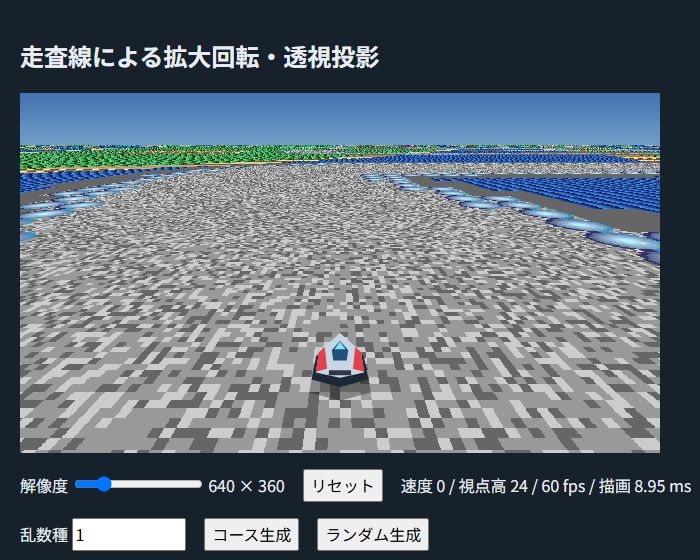

# Rotate

p5.jsで作った、走査線方式の透視投影を使うレースゲーム実験です。乱数種からコースや地形を生成し、同じ番号を指定すれば同じ配置を再現できます。

[▶ p5.js Web Editorで遊ぶ](https://editor.p5js.org/zex256/sketches/pvrmznP0L)

## ゲーム画面

## 操作方法

画面をクリックしてからキーを操作してください。

| キー | 操作 |
| --- | --- |
| `W` | 機首方向へ加速 |
| `S` | ブレーキ（停止中に後退しません） |
| `←` / `→` | 自機の旋回 |
| `A` / `D` | 走行中の左右への重心移動 |
| `↑` / `↓` | 視点を下向き / 上向きに変更 |
| `Page Up` / `Page Down` | 視点の高さを変更 |

乱数種を入力して「コース生成」を押すと、その種のコースを再現できます。「ランダム生成」では新しいコースを作ります。

## 特徴

- 自機の後方から追従する視点と、慣性・走行抵抗を備えた車両操作
- 急カーブ、シケイン、幅の変化があるコースを含む、乱数種対応の地形生成
- 512×512のタイルマップ、16×16ドットのタイル、256色パレットによる描画
- 水面や地形の色の循環、ガラス球の明暗アニメーション
- 走査線ごとに投影情報を事前計算する地上描画

## 起動方法

`index.html`をブラウザーで開くか、p5.js Web Editorのリンクから実行します。p5.js本体をCDNから読み込むため、インターネット接続が必要です。Web Editorで実行する場合は、プロジェクトの`sketch.js`を使います。
